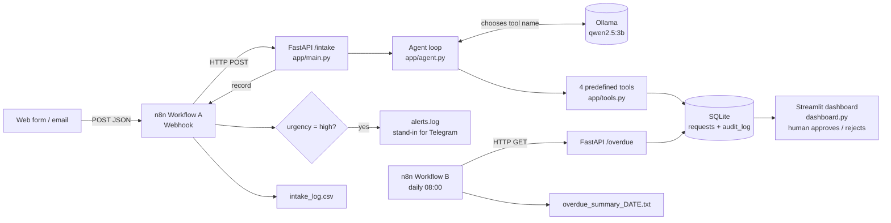

# EXPLAINER: HOMECARE intake demo

## 1. Purpose

A home-help service for elderly people gets customer requests by web form and email. Today staff read
each one, classify it, type it into a list, and have to remember to call people back. This demo automates
intake, triage, record-keeping and reply drafting with a local AI agent. A human stays in control of
every message that would go out, and every automated step is logged so it can be checked later.

## 2. Architecture



Plain-text version:

```
web form / email ──► n8n webhook ──► FastAPI /intake ──► agent ──► tools ──► SQLite ──► Streamlit dashboard
                          │                                  ▲                            (human approval)
                          ├─► IF high ──► alerts.log         └── Ollama qwen2.5:3b (picks tool names only)
                          └─► intake_log.csv
n8n schedule 08:00 ──► FastAPI /overdue ──► IF count > 0 ──► overdue_summary_<date>.txt
```

## 3. Pipeline, stage by stage

| # | Stage | Input | Output | File |
|---|---|---|---|---|
| 1 | Receive | Customer request as JSON `{text, channel, received_at}` | Same JSON forwarded to the API | n8n Workflow A, node *Webhook: new request* |
| 2 | Intake endpoint | JSON body, validated by Pydantic | Row in `requests` + `received` audit entry | `app/main.py`, `app/schemas.py`, `app/db.py` |
| 3 | Agent decides | Request text + which tools already ran | Name of the next tool (or `finish`) | `app/agent.py` |
| 4 | `extract_fields` | Request text | service_type, when_needed, urgency, callback_requested, preferred_contact_time, location, summary | `app/tools.py` |
| 5 | `check_missing_info` | Extracted fields | missing_info list (`location`, `date`, `details`) | `app/tools.py` |
| 6 | `set_priority` | Extracted fields | priority 1–5 (+ urgency safety floor) | `app/tools.py` |
| 7 | `draft_followup` | Text + missing info + callback flag | Reply draft, status `pending_approval` | `app/tools.py` |
| 8 | Respond / route | Final record | JSON reply to caller; alert line if high; CSV line always | n8n Workflow A |
| 9 | Human review | Pending drafts | `approved` / `rejected` + `human_review` audit entry | `dashboard.py` → `db.review_followup` |
| 10 | Daily check | Schedule 08:00 | `GET /overdue` → summary file if anything is overdue | n8n Workflow B, `app/main.py`, `db.list_overdue` |

"Overdue" means: a callback was requested, the request is more than 24 hours old, and no follow-up has been approved.

## 4. Data

- **Source:** `intake-service/data/synthetic_requests.json`, written by hand (by the AI assistant during the build)
  in one pass. Nothing was downloaded. All names are fictional, there are no addresses (city names only),
  and there is no real personal data.
- **Size and mix:** 50 requests. 15 high urgency, 20 medium, 15 low. 39 English, 11 German, several with
  typos or informal style. 16 ask for a callback, 9 name no city, a few are deliberately vague.
- **Structure of one item:**
  ```json
  {"id": 4, "language": "de", "channel": "web_form", "text": "Guten Tag, meine Oma in Düsseldorf ...",
   "labels": {"service_type": "shopping", "urgency": "high", "callback_requested": true,
              "preferred_contact_time": "evening", "location": "Düsseldorf", "missing_info": []}}
  ```
- **Labelling rules (ground truth):** urgency `high` = safety/health risk or needed today; `medium` = a later
  concrete day; `low` = general question or no time pressure. `missing_info` contains `location` if no city,
  `date` if no concrete day, `details` if it is unclear what help is needed. Contact time is
  `morning`/`afternoon`/`evening` only when the customer says when to contact them.
- **Regenerating:** there is no generator script. The file is a static, reviewed fixture. To change it,
  edit the JSON by hand (or ask an assistant to regenerate it under the same rules) and re-run the eval.
- **Demo seed data:** for the dashboard demo, 6 dataset requests were posted to the API, two of them
  *backdated by 2 days* so the overdue check has something to show. That backdating is simulated.

## 5. How the agent works

- **Loop (`app/agent.py`):** up to **4 steps**. At each step the model gets the request and the progress so
  far, and answers with JSON `{"tool": ..., "reason": ...}`. Python runs that tool, records it, and asks again.
- **The JSON schema is the safety mechanism.** Every call uses Ollama's `format=<JSON schema>`. For the planner,
  the `tool` field is an *enum* of only the tools that have not run yet, plus `finish`. So the model cannot
  name a tool that does not exist, repeat one, or produce free text. Output length is capped
  (`num_predict=400`) because a small model can loop endlessly (this happened once in testing).
- **The tools (`app/tools.py`)** are plain Python functions that return dicts:
  - `extract_fields`: LLM call with the `ExtractedFields` schema (from `app/schemas.py`).
  - `check_missing_info`: **rules, not the model.** No city → `location`; no concrete day → `date`; service `other` → `details`.
  - `set_priority`: **rules.** high = 1; medium = 2 with callback, else 3; low = 4 with callback, else 5.
    Safety floor: if the extracted time says today/tonight/heute/…, urgency is raised to high; a concrete day
    raises low to medium. Rules can only *raise* urgency, never lower it.
  - `draft_followup`: LLM writes a short reply in the customer's language, told never to confirm a booking or promise a time or price.
- **Guardrails:** extraction is always forced first. If extraction fails, the record gets priority 1 and
  "needs manual triage", so it is never silently sorted to the bottom. If the model finishes without the two
  rule-based tools, they run anyway. Every override is written to the audit log as `guardrail`.
- **Why the model cannot write SQL or send messages:** it only ever outputs JSON that matches a schema. Its
  only influence on the system is *which* whitelisted function runs next, plus the field values those
  functions validate. All SQL is fixed, parameterised code in `app/db.py` (column names are whitelisted
  too). There is no send function anywhere in the code: approving a draft only changes a status.

## 6. Human-in-the-loop and traceability

- **Approval states** (`requests.followup_status`): `none` → `pending_approval` (set by `draft_followup`) →
  `approved` or `rejected`, which only `db.review_followup()` can set. That function is called from the dashboard buttons.
- **Audit log** (`audit_log` table). Every entry has `request_id`, `timestamp` (UTC), `step`, `tool`, `input` (JSON), `output` (JSON).
  Steps written:
  - `received`: the raw incoming request
  - `agent_decision`: which tools were allowed, which one the model chose, and its stated reason
  - `tool_call` / `tool_error`: the tool's input (text + fields so far) and output
  - `guardrail`: any rule that overrode or completed the model's plan
  - `human_review`: approve/reject decisions
- To read the trail for request 3:
  `.\.venv\Scripts\python.exe -c "import sqlite3; [print(r) for r in sqlite3.connect('data/intake.db').execute('select timestamp, step, tool, output from audit_log where request_id=3')]"`

## 7. Evaluation

`eval/run_eval.py` runs all 50 requests through the **full agent loop** (separate database `data/eval.db`)
and compares six fields with the labels. Location is case-insensitive and missing_info is compared as a set.
Results from `eval/report.md` (qwen2.5:3b, temperature 0, ~4.4 s per request):

| Field | Accuracy |
|---|---|
| service_type | 86% |
| urgency | 78% |
| callback_requested | 94% |
| preferred_contact_time | 90% |
| location | 98% |
| missing_info | 80% |
| **all six correct** | **54%** |
| **high-urgency recall** | **15/15** |

**Known failures** (full list in the report):
- Pharmacy and medicine pick-ups are often labelled `transport` instead of `shopping`.
- Appointment times ("at 2 pm") are sometimes read as the preferred contact time.
- Over-triage: some medium cases become high, and vague low requests ("after the summer") become medium,
  because the model copies a vague phrase as a "concrete day". This is the safe direction of error.
- "near the station" was accepted as a location.

**Caveat:** prompts and rules were improved by looking at failures on these same 50 cases, and there is no
held-out test set. Expect lower accuracy on real requests.

## 8. What we did, step by step

1. **Checked the machine.** Python 3.12, Ollama with only `qwen3:4b`, Docker Engine stopped, no project folder.
   Pulled `qwen2.5:3b` (1.9 GB, fits fully on the 4 GB RTX 3050 Ti: `ollama ps` shows 100% GPU). Chose 3B
   because a 7B model would not fit in 4 GB VRAM and would spill to CPU, making each request many times slower.
2. **Scaffolding:** folder structure, pinned `requirements.txt` (FastAPI, Uvicorn, Pydantic, Streamlit, ollama), `.venv`, `.gitignore`, `.env.example`.
   Settings are read from environment variables with the `.env.example` values as defaults, so no `.env` file is needed.
3. **`db.py`:** two tables, insert/update helpers, a self-test. Column names are whitelisted in `update_request`.
4. **`schemas.py` + `tools.py`:** Pydantic models generate the JSON schemas given to Ollama, so one definition serves both validation and LLM output.
5. **`agent.py`:** planner with a narrowing enum, max 4 steps. Test on one request: correct tool sequence, ~9 s on first run.
6. **`main.py`:** `/intake`, `/overdue`, `/requests`. Testing showed the "Ollama unreachable" message was not
   shown, because the client raises `httpx.ConnectError`. Fixed, so it now says to run `ollama serve`.
7. **Evaluation.** The first full run crashed on case 8: the model got stuck repeating itself while writing
   a German reply (156,000 characters). Fix: output cap + schema-validation errors logged as `tool_error`
   + failed extraction flagged for manual triage. **Baseline** (original prompts): service_type 88%,
   urgency 72%, callback 96%, contact time 90%, location 98%, **missing_info 20%**, all correct 6%, high recall 15/15.
8. **Improvement, round 1:** `missing_info` failed because the model added "details" to almost everything.
   Decision: let the model extract *facts* (`when_needed`) and derive `missing_info` with rules. I also
   clarified the prompt rules for shopping vs transport, medium urgency, and contact time.
   Result: missing_info 80%, all correct 42%, but high recall dropped to 14/15 (a same-day dialysis ride was called medium).
9. **Improvement, round 2:** added the raise-only urgency safety floor in `set_priority`. High recall back to
   15/15, all correct 54%. Fixed one bug in the rule (bare "now" matched "now and then"). Then stopped
   tuning to avoid overfitting to the 50 cases.
10. **Dashboard:** three tabs. Checked headlessly with Streamlit's `AppTest`: renders without errors, and
    Approve changes the status, writes the audit entry and removes the item from the overdue list.
11. **n8n:** it turned out not to be installed. With the user's approval, pulled `n8nio/n8n` (v2.43.7) and
    ran it with a mounted `n8n/output` folder. Built the workflows as JSON, imported and published them with
    the n8n CLI, and tested them for real: a high and a low request through the webhook (alert written only
    for the high one, CSV line for both), and Workflow B via a manual trigger (summary file listed the overdue
    request). Added a "Run now (manual test)" trigger to B, because the CLI cannot start schedule-only workflows.
    Exported the final versions to `n8n/homecare_intake_workflow.json`.
12. **Telegram:** not configured (no token, and the brief forbids external calls), so the alert is a clearly
    named node that appends to `alerts.log`.

## 9. How to run everything (PowerShell)

```powershell
cd C:\Users\ldhar\homecare-demo\intake-service

# one-time setup
python -m venv .venv
.\.venv\Scripts\pip install -r requirements.txt
ollama pull qwen2.5:3b

# terminal 1: API (Ollama must be running; if not: ollama serve)
.\.venv\Scripts\python.exe -m uvicorn app.main:app --port 8000

# terminal 2: dashboard at http://localhost:8501
.\.venv\Scripts\python.exe -m streamlit run dashboard.py

# terminal 3: n8n. First time: create the container and import the workflows
docker run -d --name n8n -p 127.0.0.1:5678:5678 -v n8n_data:/home/node/.n8n -v "C:\Users\ldhar\homecare-demo\n8n\output:/files" -e GENERIC_TIMEZONE=Europe/Berlin -e N8N_RESTRICT_FILE_ACCESS_TO=/files n8nio/n8n
docker cp ..\n8n\homecare_intake_workflow.json n8n:/tmp/wf.json
docker exec n8n n8n import:workflow --input=/tmp/wf.json
docker exec n8n n8n publish:workflow --id=HomecareIntakeA1
docker exec n8n n8n publish:workflow --id=HomecareOverdueB
docker restart n8n
# later sessions: docker start n8n

# send a request through n8n (or POST directly to http://localhost:8000/intake)
Invoke-RestMethod -Uri http://localhost:5678/webhook/homecare-intake -Method Post -ContentType "application/json" -Body '{"text":"My father fell and cannot get up, he lives in Neuss. Please call me back now.","channel":"web_form"}'

# run Workflow B now instead of waiting for 08:00
docker exec -e N8N_RUNNERS_BROKER_PORT=5690 n8n n8n execute --id=HomecareOverdueB

# evaluation (about 4 minutes)
.\.venv\Scripts\python.exe eval\run_eval.py
```

To open the workflows in the n8n editor, go to http://localhost:5678 and create the local owner account
(first visit only). If `intake_log.csv` is deleted, recreate its header row first, because the workflow only appends.

## 10. Limitations and next steps

- **No authentication** on the API, dashboard or webhook. They run on localhost only.
- **No cloud deployment**, and no real email inbox, CRM or messaging integration. "Approve" sends nothing.
- **English and German only**, tested on **synthetic data only** (50 cases, labelled by the same author who tuned the prompts).
- **Small-model accuracy:** 54% of requests have all six fields right. Human review of every reply is a requirement, not an option.
- Not built (out of scope): editing drafts in the dashboard, an audit-log view in the dashboard,
  automatic retries, a held-out test set, Telegram alerts.
- **What production would need:** a GDPR data-protection review (lawful basis, a data processing agreement,
  retention and deletion, and health data is special-category data under Art. 9), an **EU AI Act** risk
  classification (urgency triage of elderly people's needs must be assessed carefully, with documented
  human oversight), authentication and roles, encryption at rest, monitoring of accuracy on real labelled
  traffic, and integration with the real CRM and communication channels.
